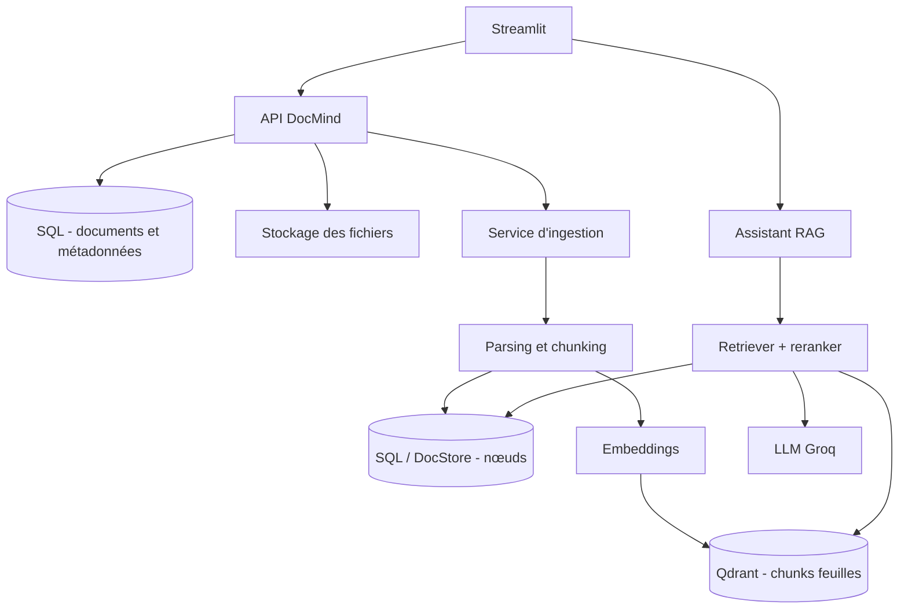

# Architecture du projet DocMind AI

## Vue d'ensemble de l'architecture

## Composants principaux

- **Streamlit** : Interface utilisateur interactive.
- **Service d'ingestion** : Traitement, chunking hiérarchique et génération d'embeddings.
- **Qdrant** : Base de données vectorielle pour les nœuds feuilles.
- **DocStore / SQL** : Stockage persistant des nœuds parents et de la structure du document.
- **LLM Groq** : Moteur d'inférence pour la génération rapide de réponses.